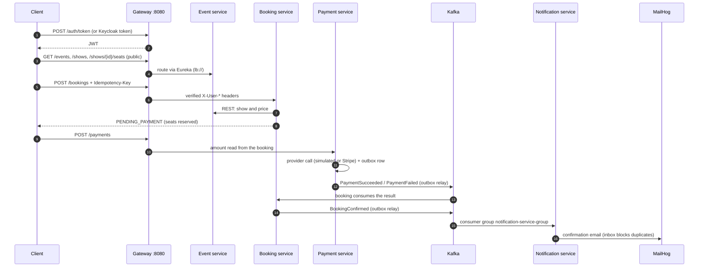

# TicketHub

Event and movie ticket booking platform built as **Spring Boot microservices**, with reliable Kafka messaging (Phase 2 sagas), a full observability stack, optional Keycloak login, S3-compatible media storage and an optional Stripe sandbox payment provider.

**Tech stack:** Java 17 · Spring Boot 3.3 · Spring Cloud 2023.0 · PostgreSQL · Kafka · Docker Compose

| Phase | What it delivers | Start here |
|---|---|---|
| Phase 1 (Epics 01-13) | Events, shows, seat booking, payment, notifications, security, observability, Docker delivery | this README |
| Phase 2 | Reliable Kafka messaging, outbox/inbox, dead letters, saga with refund, reconciliation | [docs/PHASE2_FLOW.md](docs/PHASE2_FLOW.md) · [docs/PHASE2_COVERAGE.md](docs/PHASE2_COVERAGE.md) · `scripts/phase2-lab.sh` |

> **Verification status.** The code was written and reviewed statically (Java syntax-checked), but **it could not be compiled or run in the environment where the latest additions were made**. The original services were run by the owner on Docker (13 containers healthy, `scripts/e2e.sh` passed). Everything added afterwards (marked *new*) must be confirmed on your machine: see the [First start checklist](#4-first-start-checklist).

## Contents

1. [Technology map](#1-technology-map)
2. [Architecture](#2-architecture)
3. [Run everything](#3-run-everything)
4. [First start checklist](#4-first-start-checklist)
5. [End-to-end flow](#5-end-to-end-flow)
6. [Authentication](#6-authentication)
7. [API reference (through the gateway)](#7-api-reference-through-the-gateway)
8. [Platform and tool endpoints](#8-platform-and-tool-endpoints)
9. [Phase 2: reliable messaging and sagas](#9-phase-2-reliable-messaging-and-sagas)
10. [Key design decisions](#10-key-design-decisions)
11. [Errors, enums and exception handling](#11-errors-enums-and-exception-handling)
12. [Story coverage](#12-story-coverage)
13. [Run a service locally, tests](#13-run-a-service-locally-tests)
14. [Troubleshooting](#14-troubleshooting)
15. [Not included](#15-not-included)

---

## 1. Technology map

Where each technology is used and how to see it working.

| Technology | Used for | Where in the project | How to check it |
|---|---|---|---|
| Spring Boot 3.3, Java 17 | Every service | `event`, `booking`, `payment`, `notification`, gateway, Eureka, config server | `docker compose ps` shows `healthy` |
| Spring Cloud Gateway | Single entry point, JWT check, routing (`lb://`), identity headers | `apigate-service` :8080 | `bash scripts/smoke-test.sh` |
| Eureka | Service discovery (the "phone book") | `eureka-server` :8761 | http://localhost:8761 |
| Spring Cloud Config | Central settings, no secrets | `config-server` :8888, `config-server/src/main/resources/config-repo` | http://localhost:8888/event-service/docker |
| PostgreSQL | One database per service | `event_db`, `booking_db`, `payment_db`, `notification_db` | seat uniqueness: `scripts/concurrency-test.sh 20` |
| Kafka | Events between booking, payment, notification | topic `booking-confirmed` (3 partitions, key = bookingId), retry and dead-letter topics | Kafka UI http://localhost:8090 |
| Outbox / Inbox tables | No lost and no duplicate events | `booking-service`, `payment-service` (outbox), `notification-service` (inbox) | `scripts/phase2-lab.sh` |
| Resilience (timeouts, retry, circuit breaker, rate limiter) | Safe calls to payment and email providers | payment and notification services | `simulatedOutcome: TIMEOUT` |
| JWT | Login token checked at the gateway | `apigate-service` | `POST /auth/token` |
| Keycloak *(new, optional)* | Real OAuth2/OIDC login (RS256) | profile `iam`, realm `tickethub` | http://localhost:8180 |
| MailHog | Catches all emails (fake SMTP) | notification-service sends here | http://localhost:8025 |
| MinIO / AWS S3 *(new)* | Event poster images, bucket `tickethub-media` | `MediaStorageService`, `PosterService` | MinIO console http://localhost:9001 |
| Stripe sandbox *(new, optional)* | Real payment provider in test mode | `StripeSandboxPaymentProvider`, profile `stripe` | Stripe test dashboard |
| Prometheus *(new)* | Metrics from `/actuator/prometheus` | `observability/prometheus` | http://localhost:9090/targets |
| Grafana *(new)* | Dashboards *TicketHub Overview* and *TicketHub Phase 2* | `observability/grafana` | http://localhost:3000 |
| Jaeger + OpenTelemetry *(new)* | Distributed traces (context also crosses Kafka headers) | Micrometer Tracing in all services | http://localhost:16686 |
| Structured logs *(new)* | JSON logs with `traceId`, `correlationId` | `*/src/main/resources/logback-spring.xml` | `docker compose logs booking-service` |
| ELK *(new, optional)* | Central log search | profile `elk`, `observability/logstash/pipeline/logstash.conf` | Kibana http://localhost:5601 |
| Docker Compose | Run all containers | `docker-compose.yml`, `.env.example` | `docker compose up -d --build` |
| GitHub Actions | CI: `mvn verify`, image build, integration job | `.github/workflows/ci.yml` | Actions tab |

---

## 2. Architecture

```
                         ┌────────────────────────── docker compose network ───────────────────────────┐
 client ──JWT──► :8080 apigate-service ──lb://──► event-service ◄──REST──► booking-service ──Kafka──► notification-service ──SMTP──► MailHog
                  │  (JWT check, routing,           │ event-db                │ booking-db  ▲                │ notification-db
                  │   X-User-* headers)             │                         │             │ Kafka (payment result events, Phase 2)
                  │                                 └─────────────────────────┼──────► payment-service ── payment-db
                  └── eureka-server :8761  (service discovery)   config-server :8888 (central config)
```

> Phase 1 returned the payment result by a REST call. Phase 2 replaced it with Kafka events (`PaymentSucceeded` / `PaymentFailed`) sent through an outbox.

### Services

| Service | Port | Owns |
|---|---|---|
| `apigate-service` | 8080 (only published business port) | routing, JWT validation, dev token endpoint |
| `event-service` | 8081 | events, venues, seat layout, shows, ticket price (`event_db`) |
| `booking-service` | 8082 | bookings, seat reservations, expiry, publishes `BookingConfirmed` (`booking_db`) |
| `payment-service` | 8083 | payments, simulated provider, signed webhook (`payment_db`) |
| `notification-service` | 8084 | notification records, Kafka consumer, email (`notification_db`) |
| `eureka-server` | 8761 | service discovery |
| `config-server` | 8888 | centralized configuration |

### Platform and tooling containers

| Container | URL / port | Purpose | Starts |
|---|---|---|---|
| `mailhog` | http://localhost:8025 | catches all emails (fake SMTP) | always |
| `kafka` | localhost:29092 (host), `kafka:9092` (Docker) | event bus | always |
| `minio` + `minio-init` *(new)* | http://localhost:9000 (S3 API), console http://localhost:9001 | media storage, bucket `tickethub-media` | always |
| `prometheus` *(new)* | http://localhost:9090 | metrics collection | always |
| `grafana` *(new)* | http://localhost:3000 (`admin`/`admin`) | dashboards | always |
| `jaeger` *(new)* | http://localhost:16686 | distributed traces | always |
| `kafka-ui` | http://localhost:8090 | browse topics and messages | always (Phase 2) |
| `keycloak` + `keycloak-db` *(new)* | http://localhost:8180 | OAuth2/OIDC identity provider | `--profile iam` |
| `elasticsearch`, `logstash`, `kibana` *(new)* | http://localhost:5601 | centralised log search | `--profile elk` |

**Rules of the design**

- Each service owns its database. No service reads another service's database.
- Services talk only through REST (`/internal/**`, never exposed by the gateway) and Kafka.
- Only the gateway publishes a business port. Service ports 8081-8084 and the gateway actuator (8089) are not reachable from the host.

---

## 3. Run everything

```bash
cp .env.example .env          # edit the placeholder secrets (an existing .env keeps working: new variables have defaults)
docker compose up -d --build  # first build takes several minutes
docker compose ps             # wait until every service shows "healthy"
bash scripts/smoke-test.sh    # checks routing/security
bash scripts/e2e.sh           # full journey through the gateway (needs bash, curl, jq, openssl)
bash scripts/concurrency-test.sh 20   # 20 customers race for ONE seat: exactly one must win (ST-08)
docker compose down           # stop (add -v to delete DB/Kafka/MinIO volumes)
```

Optional parts:

```bash
docker compose --profile iam up -d        # Keycloak            (also set KEYCLOAK_ENABLED=true in .env)  -> docs/KEYCLOAK.md
docker compose --profile elk up -d        # ELK log search      (also set TICKETHUB_PROFILES=docker,elk)  -> docs/OBSERVABILITY.md
docker compose --profile tools up -d      # Kafka UI
docker compose --profile full up -d       # everything (needs ~8 GB RAM for Docker)
```

Two instances of a service (SC-14): `docker compose up -d --scale event-service=2`.

On Windows run the `.sh` scripts from **Git Bash** (or WSL). `jq` is needed: `winget install jqlang.jq`, then reopen the terminal.

## 4. First start checklist

1. `docker compose up -d --build` finishes and `docker compose ps` shows all containers `healthy` (`minio-init` exits after creating the bucket, that is normal).
2. http://localhost:9090/targets shows 5 targets `UP`; http://localhost:3000 shows the dashboard with data after a few requests.
3. `bash scripts/e2e.sh` prints `E2E PASSED` (it also uploads a poster; use `CHECK_POSTER=0` to skip that step).
4. In Jaeger, pick `booking-service`, open a trace: you should see the call chain across services.
5. `docker compose logs booking-service --tail 5` prints JSON lines (set `TICKETHUB_LOG_APPENDER=CONSOLE` for text).

If a *new* piece fails, it is isolated: see [Troubleshooting](#14-troubleshooting).

---

## 5. End-to-end flow

Each step shows the endpoint and which technology is involved.

### 5.1 Booking journey



| Step | What happens | Endpoint | Technology |
|---|---|---|---|
| 1. Login | Customer or admin gets a JWT | `POST /auth/token` (dev) or Keycloak `:8180` | JWT, Keycloak |
| 2. Browse | Public events, shows and seat map | `GET /events`, `GET /shows`, `GET /shows/{showId}/seats` | Gateway, Eureka, PostgreSQL |
| 3. Book | Seats reserved, price snapshot taken, status `PENDING_PAYMENT`. Same `Idempotency-Key` returns the original booking (HTTP 200) | `POST /bookings` | PostgreSQL unique index, REST to event-service |
| 4. Pay | Amount comes from the booking, never from the client | `POST /payments` | Resilience, simulated provider or Stripe |
| 5. Provider result | Direct result or signed callback (HMAC `X-Signature`, duplicates ignored) | `POST /payments/webhook` | HMAC-SHA256 |
| 6. Confirm | Payment event travels over Kafka. Booking becomes `CONFIRMED`, seats `BOOKED` | `GET /bookings/{id}` | Kafka, outbox |
| 7. Notify | Email (and optional PUSH) recorded and sent | `GET /notifications` (ADMIN) | Kafka consumer, inbox, MailHog |
| 8. Track | State, plain-language reason and timeline | `GET /bookings/{id}/saga` | saga log |

### 5.2 Other paths

| Situation | What happens |
|---|---|
| Customer does not pay | A scheduler marks overdue `PENDING_PAYMENT` bookings `EXPIRED` and frees the seats. A payment that succeeds after expiry is recorded as `REJECTED_EXPIRED` and the booking is never confirmed. |
| Customer cancels | `POST /bookings/{id}/cancel` publishes `BookingCancelled`. Payment refunds and publishes `PaymentRefunded`. |
| Two customers pick one seat | The database unique index decides. The loser gets `409 SEAT_UNAVAILABLE`. |
| Email provider is down | The booking is never affected. Notification retries on retry topics, then parks the message on `booking-confirmed-dlt`. An admin can list and replay it. |
| Payment and booking disagree | The reconciliation job finds it and writes a report. |

### 5.3 Booking status lifecycle

`PENDING_PAYMENT` → `CONFIRMED`, `PAYMENT_FAILED`, `CANCELLED` or `EXPIRED`. Each status enum contains its own allowed transitions (`canTransitionTo`).

### 5.4 Observing one request

1. Make a booking and payment.
2. **Jaeger:** pick `booking-service` and open the trace (gateway, booking, event, payment).
3. **Grafana:** request rates, errors, Kafka lag and `tickethub_*` business metrics.
4. **Logs:** `docker compose logs booking-service` shows JSON with the same `traceId` and `correlationId` that appear in error responses.
5. **Kafka UI:** see the `BookingConfirmed` message and the group `notification-service-group`.
6. **MailHog:** see the email.
7. **MinIO console:** see the uploaded poster in `tickethub-media`.

---

## 6. Authentication

`POST /auth/token` on the gateway issues a JWT when `DEV_TOKEN_ENABLED=true`:

```bash
curl -s -X POST localhost:8080/auth/token -H 'Content-Type: application/json' \
  -d '{"userId":"alice","email":"alice@example.com"}'                       # CUSTOMER
curl -s -X POST localhost:8080/auth/token -H 'Content-Type: application/json' \
  -d '{"userId":"admin-1","email":"a@x.com","roles":["ADMIN"],"adminKey":"<DEV_ADMIN_KEY>"}'
```

Send the token on every protected call: `Authorization: Bearer <token>`.

The gateway validates the JWT, strips any client-sent `X-User-*` headers and forwards the verified identity. Customer identity is never taken from a request body.

**Keycloak (new, optional):** with `KEYCLOAK_ENABLED=true` and `docker compose --profile iam up -d`, the gateway also accepts RS256 access tokens issued by Keycloak (realm `tickethub`, users `admin`/`alice`/`bob`/`john`), verified against Keycloak's public keys. Dev tokens keep working side by side. Details: [docs/KEYCLOAK.md](docs/KEYCLOAK.md). Run the full flow with real logins: `AUTH_MODE=keycloak bash scripts/e2e.sh`.

---

## 7. API reference (through the gateway)

Base URL: `http://localhost:8080`

| Area | Endpoints | Access |
|---|---|---|
| Auth | `POST /auth/token` | public (dev only) |
| Events | `GET /events`, `GET /events/{id}` | public |
| | `POST /events`, `PUT /events/{id}`, `PATCH /events/{id}/status` | ADMIN |
| | `POST /events/{id}/poster` (multipart field `file`, JPEG/PNG/WebP up to 5 MB, stored in S3/MinIO) *(new)* | ADMIN |
| Venues | `POST /venues`, `PUT /venues/{id}`, `GET /venues`, `POST /venues/{id}/seats`, `GET /venues/{id}/seats` | ADMIN |
| Shows | `GET /shows`, `GET /shows/{id}`, `GET /shows/{showId}/seats` | public |
| | `POST /shows`, `PUT /shows/{id}`, `PATCH /shows/{id}/status` | ADMIN |
| Bookings | `POST /bookings` (+ `Idempotency-Key` header), `GET /bookings/{id}`, `GET /bookings`, `POST /bookings/{id}/cancel` | logged-in customer |
| Payments | `POST /payments`, `GET /payments/{id}` | logged-in customer |
| | `POST /payments/webhook` (HMAC `X-Signature` over the raw body) | provider callback |
| Notifications | `GET /notifications`, `GET /notifications/{id}` (operations view) | ADMIN |
| *Phase 2* Dead letters | `GET /notifications/dead-letters?status=PARKED`, `POST /notifications/dead-letters/{id}/replay` | ADMIN |
| *Phase 2* Saga view | `GET /bookings/{id}/saga` (state, plain-language reason, timeline) | owner or ADMIN |
| *Phase 2* Reconciliation | `POST /payments/reconciliation/run`, `GET /payments/reconciliation/report` | ADMIN |

Request bodies for each call are used in `scripts/e2e.sh`, which is the reference for exact field names.

OpenAPI per service: `http://<service>:<port>/swagger-ui.html` (run the service locally, internal ports are not published in Docker).

**Internal endpoints** (`/internal/**`) are for service-to-service calls only and are never exposed by the gateway. They can be protected with the shared `X-Internal-Key` header (set `INTERNAL_API_KEY` in `.env`, off by default). The old `/internal/bookings/{id}/payment-result` endpoint still exists but payment no longer calls it.

### Idempotency and signature rules

- `POST /bookings` needs an `Idempotency-Key`. The same key from the same customer returns the original booking.
- The webhook signature is HMAC-SHA256 over the raw body, sent in `X-Signature`, compared in constant time. The secret is `PAYMENT_WEBHOOK_SECRET`. A repeated event id returns `DUPLICATE_IGNORED`.
- Payment initiation is never retried, so a customer is never charged twice.

---

## 8. Platform and tool endpoints

These are the endpoints of the integrated technologies (host URLs from `docker-compose.yml`). Paths after the port are each tool's standard API.

| Technology | Base URL | Useful endpoints | Expected |
|---|---|---|---|
| Eureka | http://localhost:8761 | `GET /eureka/apps` (header `Accept: application/json`), `GET /eureka/apps/BOOKING-SERVICE` | all five services `UP` |
| Config server | http://localhost:8888 | `GET /{service}/docker`, for example `/event-service/docker` | settings of that service (the page on `/` is a normal whitelabel) |
| Prometheus | http://localhost:9090 | `GET /-/healthy`, `GET /api/v1/targets`, `GET /api/v1/query?query=up`, `GET /api/v1/rules`, `GET /api/v1/alerts` | 5 targets `UP` |
| Grafana | http://localhost:3000 (`admin`/`admin`) | `GET /api/health`, `GET /api/datasources`, `GET /api/search?query=TicketHub` (Basic Auth) | dashboards *TicketHub Overview*, *TicketHub Phase 2* |
| Jaeger | http://localhost:16686 | `GET /api/services`, `GET /api/traces?service=booking-service&limit=5` | traces across services |
| MailHog | http://localhost:8025 | `GET /api/v2/messages`, `GET /api/v2/search?kind=to&query=alice@example.com`, `DELETE /api/v1/messages` | confirmation email |
| Kafka UI | http://localhost:8090 | `GET /api/clusters`, then `GET /api/clusters/{cluster}/topics`, `.../consumer-groups` | `booking-confirmed`, `booking-confirmed-dlt`, group `notification-service-group` |
| Kafka (from host) | `localhost:29092` | use Kafka UI or a Kafka client | |
| MinIO | S3 API http://localhost:9000, console http://localhost:9001 | `GET :9000/minio/health/live`, `GET :9000/minio/health/ready` | bucket `tickethub-media` with posters |
| Keycloak *(profile `iam`)* | http://localhost:8180 | `GET /realms/tickethub/.well-known/openid-configuration`, `GET /realms/tickethub/protocol/openid-connect/certs`, `POST /realms/tickethub/protocol/openid-connect/token` | tokens for `admin`/`alice`/`bob`/`john` (client id and passwords: `keycloak/realm/tickethub-realm.json`) |
| Kibana *(profile `elk`)* | http://localhost:5601 | `GET /api/status`, UI: Discover | logs searchable by `correlationId` / `traceId` |
| Service actuator | inside Docker only | `/actuator/prometheus` on every service, gateway actuator on port **8089** | read by Prometheus; not reachable through port 8080 |

**Stripe sandbox (optional):** there is no separate endpoint. It runs behind `POST /payments`. Enable with `TICKETHUB_PROFILES=docker,stripe` and `STRIPE_SECRET_KEY=sk_test_...` (a live key is refused at start-up), then check the payment in the Stripe test dashboard. Test card token: `pm_card_visa`. The payment id is used as the Stripe Idempotency-Key.

**Media (poster upload) flow:** `POST /events/{id}/poster` validates type and size, uploads through the S3 API (MinIO locally, AWS S3 in the cloud, same code with different `tickethub.media.*` settings) and saves the public URL on the event. The remote upload never runs inside a database transaction.

---

## 9. Phase 2: reliable messaging and sagas

Phase 2 makes Kafka messaging reliable and turns "pay for a booking" into a **saga** (a chain of local steps with an undo). The project uses choreography (services react to each other's events): see [docs/SAGA_DECISION.md](docs/SAGA_DECISION.md). Saga states: `PAYMENT_PENDING`, `CONFIRMED`, `COMPENSATING`, `COMPENSATED`, `FAILED`.

- **Outbox (sender):** the business change and the outgoing event are saved in the same database transaction. A relay job publishes to Kafka. No event is lost.
- **Inbox (receiver):** the event id is saved in the same transaction as the work. The unique id blocks duplicates.

| # | Problem | What was added | Where |
|---|---|---|---|
| S0 | can't see inside Kafka | Kafka UI always on at http://localhost:8090 | `docker-compose.yml` |
| S1 | a bad message blocks the consumer | retry topics + dead-letter topic + dead-letter API (list, fix, replay) | `notification-service/.../consumer`, `DeadLetterController` |
| S2 | the same event arrives twice | **inbox** table, unique event id, written in the same transaction as the notification | `InboxRepository`, `NotificationRecorder` |
| S3 | event lost between DB commit and Kafka | **outbox** table + relay job | `booking-service/.../outbox`, `payment-service/.../outbox` |
| S4 | money taken, booking not confirmed | Payment publishes `PaymentSucceeded/Failed`; Booking consumes them (no REST callback) | `PaymentEventsConsumer`, `PaymentEventHandler` |
| S5 | late payment / cancel after confirm | `BookingRejected/Cancelled` -> refund -> `PaymentRefunded` (idempotent) | `PaymentRefundService`, `BookingService` |
| S6 | out-of-order events | key = bookingId, per-booking version numbers, stale events ignored | `aggregate_version` columns |
| S7 | where is booking X stuck? | saga state + timeline: `GET /bookings/{id}/saga` | `SagaLog`, [docs/SAGA_DECISION.md](docs/SAGA_DECISION.md) |
| S8 | payment and booking disagree | reconciliation job + report | `payment-service/.../reconciliation` |
| S9 | duplicate / late / lost provider callbacks | forward-only status machine, `UNKNOWN` state, provider lookup | `PaymentStatus`, `ProviderInvoker.lookup` |
| S10 | email provider down | circuit breaker + rate limiter + retry topics | `EmailDeliveryGuard` |
| S11 | consumer falls behind | lag metrics + alert rules + scaling lab | `observability/prometheus/alerts.yml`, `phase2-lab.sh s11-lag` |
| S12 | rebuild state from history | replay consumer (new group, own DB, never sends) | compose profile `replay`, `notification-service-replay.yml` |
| S13 | event contract must change | v2 adds fields, keeps old one; consumers ignore unknown fields | `BookingConfirmedEvent` (both services) |
| ST-71 | service crashes after payment | kill-and-restart drill: `phase2-lab.sh s15-crash` | `scripts/` |
| ST-76 | service-to-service auth | shared `X-Internal-Key` on `/internal/**` (off by default) | `InternalApiKeyFilter` |
| ST-77 | advanced incident analysis | `tickethub_*` business metrics, Grafana dashboard *TicketHub Phase 2*, more alerts | `observability/` |
| ST-78 | S3/RDS operations | SSE, versioning/lifecycle, pool limits, `scripts/db-restore-drill.sh`, [docs/HARDENING.md](docs/HARDENING.md) | |
| ST-79 | second channel | PUSH notifications next to EMAIL (simulated provider), independent status and circuit breaker | `PushNotificationSender` |
| S14 | everything breaks | `scripts/phase2-lab.sh s14-chaos` + [incident template](docs/INCIDENT_TEMPLATE.md) | `scripts/` |

Try it: `docker compose up -d --build`, then `bash scripts/e2e.sh` (also tests cancel and refund), then `bash scripts/phase2-lab.sh` (lists one command per scenario).

---

## 10. Key design decisions

- **No double booking (ST-08):** partial unique index `uq_active_show_seat (show_id, seat_id) WHERE state <> 'AVAILABLE'`. The database decides races; the loser gets `409 SEAT_UNAVAILABLE`.
- **Price snapshot (ST-46):** booking amount = show price × seats at creation. Payment takes the amount from the booking. Clients can't send amounts.
- **Idempotent booking (ST-53):** `Idempotency-Key` + unique `(customer_id, idempotency_key)`. A retry returns the original (HTTP 200).
- **Expiry (ST-09):** a scheduler marks overdue `PENDING_PAYMENT` bookings `EXPIRED` and frees seats. An expired booking is never confirmed (payment success after expiry is recorded as `REJECTED_EXPIRED`).
- **Payment to booking result (ST-02/55/56):** Phase 1 used a REST call. Phase 2 replaced it with events (`PaymentSucceeded` / `PaymentFailed` on Kafka via an outbox).
- **Webhook (ST-23/24):** HMAC-SHA256 over the raw body, constant-time compare, processed-event table (duplicates return `DUPLICATE_IGNORED`), late or conflicting callbacks ignored.
- **Kafka (ST-19/20/58/60):** topic `booking-confirmed` (3 partitions, key = bookingId), published **after commit**. Notification consumes in group `notification-service-group`. Duplicates are blocked by unique `source_event_id`. A failed email never touches the booking. Demo: `scripts/kafka-groups-demo.sh`.
- **Resilience (ST-16/17/18):** explicit timeouts on every remote call, bounded retry only for idempotent calls (payment initiation is never retried), circuit breakers with fail-fast controlled errors. Simulate latency or outage with `payment.simulator.*` or `simulatedOutcome: TIMEOUT`.
- **Media (ST-30) *(new)*:** see the media flow in section 8.
- **Real provider sandbox (ST-22) *(new)*:** `StripeSandboxPaymentProvider` (Stripe TEST mode). Off by default. Limitation: Stripe's own webhook signature format is not implemented; the sandbox flow confirms synchronously.
- **Config (ST-13):** the config repo contains no secrets. Passwords and keys come from environment variables.

---

## 11. Errors, enums and exception handling

Standard error format returned by every service and the gateway:

```json
{"timestamp":"...","status":409,"error":"Conflict","code":"SEAT_UNAVAILABLE","message":"...","path":"/bookings","correlationId":"...","fieldErrors":[]}
```

Every service has the same `GlobalExceptionHandler` (`@RestControllerAdvice`) and a `BusinessException` hierarchy: 404 not found, 409 conflict / seat unavailable / invalid transition, 422 business rule, 401/403, 502-504 dependency errors, 400 validation / malformed. Stack traces and internals are never returned. Unexpected errors return a generic 500 with the `correlationId` (also in logs via MDC). The gateway has its own handler so routing failures (no route 404, no instance 503, timeout 504) use the same format.

**Enums**

`EventStatus` (DRAFT, PUBLISHED, CANCELLED) · `ShowStatus` (SCHEDULED, OPEN, SOLD_OUT, CANCELLED, COMPLETED) · `EventType` · `VenueStatus` · `SeatCategory` · `CurrencyCode` · `SeatReservationState` (AVAILABLE, RESERVED, BOOKED) · `BookingStatus` (PENDING_PAYMENT, CONFIRMED, PAYMENT_FAILED, CANCELLED, EXPIRED) · `PaymentResult`, `PaymentResultOutcome` · `PaymentStatus` (INITIATED, PENDING, UNKNOWN, SUCCESS, FAILED, CANCELLED, REFUNDED) · `ProviderStatus`, `SimulatedOutcome`, `PaymentProviderName`, `WebhookOutcome` · `NotificationChannel` (EMAIL, PUSH) · `NotificationStatus` (PENDING, SENT, RETRYING, DEAD, REPLAYED, FAILED) · `SagaState` (PAYMENT_PENDING, CONFIRMED, COMPENSATING, COMPENSATED, FAILED) · `NotificationType` · `Role` · `ErrorCode`.

Lifecycle enums contain their own transition rules (`canTransitionTo`).

---

## 12. Story coverage

### Epic 13: delivery

| Story | Where |
|---|---|
| ST-61 local infrastructure | `docker-compose.yml` (4 Postgres + volumes, Kafka, MailHog), `.env.example` |
| ST-32 Dockerize | `*/Dockerfile` (pinned tags, non-root, HEALTHCHECK), compose health-gated startup, CI image build |
| ST-33 repeatable deployment | `docker compose up -d --build` + `scripts/smoke-test.sh` |
| ST-34 release and rollback | `scripts/release.sh v1.0.0` / `scripts/rollback.sh v0.9.0` (image tag via `TICKETHUB_TAG`) |
| ST-62 end-to-end | `scripts/e2e.sh` |
| CI | `.github/workflows/ci.yml`: `mvn verify`, image build, and an *(new)* integration job that starts the stack and runs smoke, e2e and concurrency tests |

### Observability, security, cloud *(new)*

| Story | Where |
|---|---|
| ST-15 Keycloak | `keycloak/realm/tickethub-realm.json`, compose profile `iam`, `KeycloakTokenVerifier` + `TokenVerifier` in the gateway, [docs/KEYCLOAK.md](docs/KEYCLOAK.md) |
| ST-25 structured logs | `*/src/main/resources/logback-spring.xml` (JSON in Docker), MDC `traceId`/`correlationId` |
| ST-26 ELK | compose profile `elk`, `observability/logstash/pipeline/logstash.conf`, Kibana data view auto-created |
| ST-27 metrics | `/actuator/prometheus` on every service, `observability/prometheus`, `observability/grafana` dashboard |
| ST-28 tracing | Micrometer Tracing + OpenTelemetry -> Jaeger; trace context also crosses Kafka headers |
| ST-29 incident lab | `scripts/incident-lab.sh`, [docs/INCIDENT_LAB.md](docs/INCIDENT_LAB.md) |
| ST-30 S3 media | `MediaStorageService`, `PosterService`, MinIO container |
| ST-31 RDS + secrets | `config-repo/*-aws.yml`, `docker-compose.aws.yml`, [docs/AWS_RDS_AND_SECRETS.md](docs/AWS_RDS_AND_SECRETS.md) (guide only, needs your AWS account) |
| ST-22 provider sandbox | `StripeSandboxPaymentProvider`, profile `stripe` |
| ST-08 concurrency proof | `scripts/concurrency-test.sh` (+ CI job) |

The gateway's actuator listens on the unpublished management port **8089** (health check and Prometheus use it), so `/actuator/*` is not reachable through port 8080.

---

## 13. Run a service locally, tests

### Run a service locally (without Docker)

Start infra only:

```bash
docker compose up -d event-db booking-db payment-db notification-db kafka mailhog
```

Then run `eureka-server`, `config-server`, the services and the gateway with `mvn spring-boot:run` (each in its own terminal). Export `SPRING_DATASOURCE_PASSWORD` (= `POSTGRES_PASSWORD`), `PAYMENT_WEBHOOK_SECRET` (payment) and `JWT_SECRET`, `DEV_TOKEN_ENABLED`, `DEV_ADMIN_KEY` (gateway).

### Tests

- **Unit tests:** status transition rules, webhook signature, JWT + public endpoints, message building, token verification (dev + Keycloak paths), poster validation, Stripe adapter against a local fake of Stripe's API. Run: `mvn verify`.
- **System tests** (need the running stack): `scripts/smoke-test.sh`, `scripts/e2e.sh`, `scripts/concurrency-test.sh`, `scripts/incident-lab.sh`. CI runs them in the `integration` job.
- Docker image builds skip test compilation (`-Dmaven.test.skip=true`), so a test problem can never block a deployment. CI is where tests run.

| Script | What it proves |
|---|---|
| `smoke-test.sh` | routing and security |
| `e2e.sh` | token, event, show, booking, payment, confirmation, email, poster, cancel and refund |
| `concurrency-test.sh 20` | 20 customers race for one seat; exactly one wins |
| `incident-lab.sh` | finding a failure with metrics, traces and logs |
| `phase2-lab.sh` | one command per Phase 2 scenario |
| `release.sh` / `rollback.sh` | release and rollback by image tag |

---

## 14. Troubleshooting

| Symptom | Fix |
|---|---|
| `bash: jq: command not found` | `winget install jqlang.jq`, reopen Git Bash |
| `exec /bin/bash failed` in PowerShell | you used the WSL shim without a distro; open **Git Bash** instead |
| Whitelabel page on :8888 | normal: open `http://localhost:8888/event-service/docker` |
| Kafka UI refused on :8090 | it is part of the normal stack now (Phase 2): `docker compose up -d kafka-ui` |
| Booking stays `PENDING_PAYMENT` after paying | confirmation travels over Kafka now; wait a few seconds, then check `docker compose logs booking-service payment-service` and the outbox tables (docs/PHASE2_RUNBOOKS.md) |
| Gateway healthy check fails after upgrading | rebuild: `docker compose up -d --build apigate-service` (health moved to port 8089) |
| Keycloak tokens give 401 | `KEYCLOAK_ENABLED=true`, recreate the gateway, request the token from `http://localhost:8180` |
| Poster upload gives 503 | `docker compose logs minio minio-init`; the bucket must exist |
| No traces in Jaeger | `docker compose logs jaeger`; services must run with the `docker` profile |
| Elasticsearch exits | give Docker Desktop more memory (4 GB+), or do not use the `elk` profile |
| Elasticsearch: `max virtual memory areas` too low | Linux: `sudo sysctl -w vm.max_map_count=262144`. WSL2: `wsl -d docker-desktop sysctl -w vm.max_map_count=262144` |
| Windows line-ending errors in `.sh` | `sed -i 's/\r$//' scripts/*.sh .env` (`.gitattributes` prevents this in Git) |

---

## 15. Not included

- **Razorpay.** This project has the *simulated* provider and the *Stripe test-mode* provider behind one `PaymentProviderGateway` interface, and refunds/lookup are implemented for those two. A Razorpay adapter would be a third class implementing the same interface.
- **Kafka topic names** follow the Phase 1 style (`booking-confirmed`, dead-letter topic `booking-confirmed-dlt`), not the guide's dotted style (`booking.confirmed.DLT`).
- **Nothing in this delivery was compiled or run by the author** (no Maven/Docker access where it was written). See *Phase 2: what is verified* in docs/PHASE2_FLOW.md.
- **Stripe's own webhook signature format** (the simulated provider's HMAC webhook is implemented).
- **A real AWS deployment** (guide and profile files only) and Kubernetes/production hardening.
- Services trust the identity headers added by the gateway, and `/internal/**` is protected only by network isolation (service ports are not published). Add mutual TLS or an internal API key before exposing services directly.
- Keycloak realm users and the MinIO/Grafana default passwords are for local learning only.
